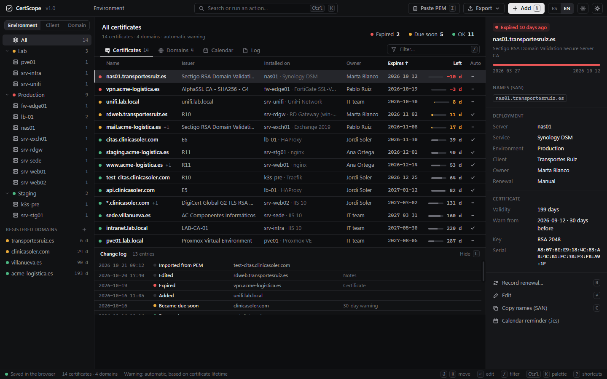

*[Español](README.md) · **English***

# CertScope

**Which certificate expires, where it's installed and who renews it.** An inventory of TLS certificates and domains in a single HTML file. No server, no install, and no data ever leaves your computer.

[RackScope](https://github.com/marcosblg/rackscope) tells you *where* each device is, [SubnetScope](https://github.com/marcosblg/subnetscope) *which IP it has* and [AssetScope](https://github.com/marcosblg/assetscope) *when its warranty ends*. CertScope tells you *when the certificate on it expires*.

Public CAs are shortening certificate validity: 200 days from March 2026, 100 from March 2027 and 47 from March 2029. What used to be renewed once a year now gets renewed every few weeks, and the spreadsheet with the dates can't keep up.

🌐 In English and Spanish: it opens in your browser's language and switches with the **ES / EN** button.

## What it does

**At a glance**
- On opening you see how many certificates are **expired**, **due soon** and **OK**, sorted by what expires first.
- Tree by **environment**, **client** or **domain**, with each server below.
- A card for each certificate: names (SAN), issuer, server and service it's installed on, owner, automatic or manual renewal, key, serial number and SHA-256 fingerprint.
- If an **auto-renewing** certificate becomes due soon, it's flagged: the renewal job is probably failing.

**Import without typing**
- Paste the **PEM** or drop a `.pem`, `.crt`, `.cer` or `.der` file: name, SANs, issuer, dates, key, serial and fingerprint fill themselves in.
- Paste the whole chain and only the server certificate is kept.
- If one with the same name already exists and expires earlier, it's recorded as a **renewal**.
- The certificate is read in the browser. If you also paste the private key, it's ignored and you're warned.

**Automatic warning**
- By default it warns at **a third of the certificate's lifetime, at most 30 days before**: a 47-day certificate warns 16 days before and one of 90 days or more, 30 days before.
- If you don't know when it was issued, the lifetime is estimated from the CA/Browser Forum schedule.
- Domains warn 30 days before. In *Settings* you can set a fixed period for everything.

**Domains**
- Registrar, expiry date, client and auto-renewal. An up-to-date certificate doesn't help if the domain lapses.
- The domain card lists every certificate under it.

**Reminders without a server**
- **Calendar (.ics)** with one event per reminder for Outlook or Google Calendar: when each one's warning starts, 7 days before and on the expiry day.
- **On opening**, anything that became due soon or expired since your last visit shows at the top, marked NEW.

**The usual**
- **PDF** report, **CSV for Excel** and **JSON** backup.
- **Saved to your own file**: link it once and it's rewritten every time you change something.
- Change log, undo and redo (Ctrl+Z / Ctrl+Y), command palette (Ctrl+K), keyboard shortcuts and light or dark theme.

## What it doesn't do (on purpose)

It doesn't scan the network or connect to your servers to read the certificate: the HTML can't reach the Internet. It doesn't renew anything or track software licences either. certbot, win-acme and friends do the renewing; CertScope tells you what needs renewing and where.

## How to use it

1. Download `index.html`.
2. Double-click it to open in Chrome, Edge or Firefox. It starts with sample data.
3. In *Settings* click **Start blank** and paste your certificates' PEM (key **I**).
4. Click bottom left to have it save automatically to a file of your own.

File linking works in Chrome and Edge. In Firefox it's saved in the browser and you can export the JSON whenever you like.

To check the certificate reader and the calendar, open `index.html#selftest`: the tab title tells you whether everything passed.

## Data format

See the [Spanish README](README.md#formato-de-los-datos). Field names are in Spanish (`hasta` = expires, `desde` = valid from, `emisor` = issuer, `servidor` = server). `cfg.aviso: 0` means the automatic warning; any other number is a fixed number of days.

## Privacy

Everything runs inside your browser. The HTML blocks any Internet connection (`connect-src 'none'` security policy): no analytics, no external fonts, no third-party libraries.

## License

AGPL-3.0. You can use and modify it freely, including inside your company. If you distribute a modified version or offer it as a service, you must publish the code under this same license.

The **CertScope** name and visual identity are not covered by the code license: if you publish a derivative, give it another name.

**Using it at your company?** If you need a license that doesn't require publishing your code, or support, message me on LinkedIn: https://es.linkedin.com/in/marcos-belmonte-gomez-9b5a71205
