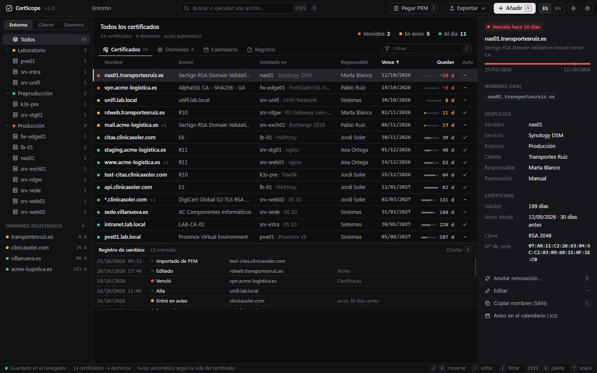

***Español** · [English](README.en.md)*

# CertScope

**Qué certificado vence, dónde está instalado y quién lo renueva.** Inventario de certificados TLS y dominios en un solo archivo HTML. Sin servidor, sin instalación y sin que salga un dato de tu equipo.

[RackScope](https://github.com/marcosblg/rackscope) te dice *dónde está* cada equipo, [SubnetScope](https://github.com/marcosblg/subnetscope) *qué IP tiene* y [AssetScope](https://github.com/marcosblg/assetscope) *cuándo caduca su garantía*. CertScope te dice *cuándo caduca el certificado que lleva*.

Las CA públicas están acortando la validez de los certificados: 200 días desde marzo de 2026, 100 desde marzo de 2027 y 47 desde marzo de 2029. Lo que antes se renovaba una vez al año pasa a renovarse cada pocas semanas, y la hoja de cálculo con las fechas ya no da abasto.

🌐 En español y en inglés: sale en el idioma de tu navegador y se cambia con el botón **ES / EN**.



## Qué hace

**De un vistazo**
- Al abrir ves cuántos certificados están **vencidos**, **en aviso** y **al día**, ordenados por lo que vence antes.
- Árbol por **entorno**, **cliente** o **dominio**, con cada servidor debajo.
- Ficha de cada certificado: nombres (SAN), emisor, servidor y servicio donde está instalado, responsable, renovación automática o manual, clave, nº de serie y huella SHA-256.
- Si un certificado con **renovación automática** entra en aviso, te lo marca: la tarea de renovación probablemente está fallando.

**Importar sin teclear**
- Pega el **PEM** o arrastra un `.pem`, `.crt`, `.cer` o `.der`: se rellenan solos el nombre, los SAN, el emisor, las fechas, la clave, el nº de serie y la huella.
- Si pegas la cadena entera, se queda solo con el certificado del servidor.
- Si ya existe uno con el mismo nombre que vence antes, se anota como **renovación**.
- El certificado se lee en el navegador. Si pegas también la clave privada, se ignora y te avisa.

**Aviso automático**
- Por defecto avisa con **un tercio de la vida del certificado, como mucho 30 días antes**: uno de 47 días avisa 16 días antes y uno de 90 o más, 30 días antes.
- Si no sabes cuándo se emitió, estima la vida por el calendario del CA/Browser Forum.
- Los dominios avisan 30 días antes. En *Ajustes* puedes poner un plazo fijo para todo.

**Dominios**
- Registrador, fecha de caducidad, cliente y renovación automática. De nada sirve un certificado al día si caduca el dominio.
- Desde la ficha del dominio ves todos los certificados que cuelgan de él.

**Avisos sin servidor**
- **Calendario (.ics)** con un evento por aviso para Outlook o Google Calendar: cuando empieza el aviso de cada uno, 7 días antes y el día que vence.
- **Al abrir**, lo que ha entrado en aviso o ha vencido desde tu última visita sale arriba y marcado como NUEVO.

**Lo de siempre**
- Informe en **PDF**, **CSV para Excel** y **JSON** de copia de seguridad.
- **Guardado en un archivo tuyo**: lo vinculas una vez y se reescribe solo cada vez que cambias algo.
- Registro de cambios, deshacer y rehacer (Ctrl+Z / Ctrl+Y), paleta de comandos (Ctrl+K), atajos de teclado y tema claro u oscuro.

## Lo que no hace (a propósito)

No escanea la red ni se conecta a tus servidores para leer el certificado: el HTML no puede salir a Internet. Tampoco renueva nada ni gestiona licencias de software. Para renovar ya están certbot, win-acme y compañía; CertScope te dice qué hay que renovar y dónde.

## Cómo usarlo

1. Descarga `index.html`.
2. Ábrelo con doble clic en Chrome, Edge o Firefox. Arranca con datos de ejemplo.
3. En *Ajustes* pulsa **Empezar en blanco** y pega el PEM de tus certificados (tecla **I**).
4. Pulsa abajo a la izquierda para que se guarde solo en un archivo tuyo.

El vínculo con el archivo funciona en Chrome y Edge. En Firefox se guarda en el navegador y puedes exportar el JSON cuando quieras.

Para comprobar el lector de certificados y el calendario, abre `index.html#selftest`: el título de la pestaña dice si todo está bien.

## Formato de los datos

```json
{
  "v": 1,
  "app": "certscope",
  "cfg": { "aviso": 0, "empresa": "" },
  "certs": [
    {
      "id": "c1",
      "cn": "www.ejemplo.es",
      "san": ["www.ejemplo.es", "ejemplo.es"],
      "emisor": "R11",
      "desde": "2026-10-01",
      "hasta": "2026-12-30",
      "servidor": "srv-web01",
      "servicio": "nginx",
      "entorno": "Producción",
      "cliente": "",
      "responsable": "Sistemas",
      "auto": true,
      "clave": "EC P-256",
      "serie": "04:A1:…",
      "huella": "DB:A4:…",
      "notas": ""
    }
  ],
  "doms": [
    { "id": "d1", "nombre": "ejemplo.es", "registrador": "IONOS", "hasta": "2027-03-01", "cliente": "", "responsable": "", "auto": true, "notas": "" }
  ],
  "log": []
}
```

`aviso: 0` es el aviso automático; cualquier otro número son días fijos.

## Privacidad

Todo funciona dentro de tu navegador. El HTML bloquea cualquier conexión a Internet (política de seguridad `connect-src 'none'`): ni analítica, ni fuentes externas, ni librerías de terceros.

## Licencia

AGPL-3.0. Puedes usarlo y modificarlo libremente, también dentro de tu empresa. Si distribuyes una versión modificada o la ofreces como servicio, tienes que publicar el código con esta misma licencia.

El nombre **CertScope** y su identidad visual no entran en la licencia del código: si publicas un derivado, ponle otro nombre.

**¿Lo usáis en vuestra empresa?** Si necesitáis una licencia que no obligue a publicar vuestro código, o soporte, escribidme por LinkedIn: https://es.linkedin.com/in/marcos-belmonte-gomez-9b5a71205
